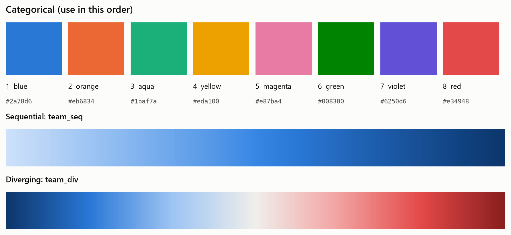
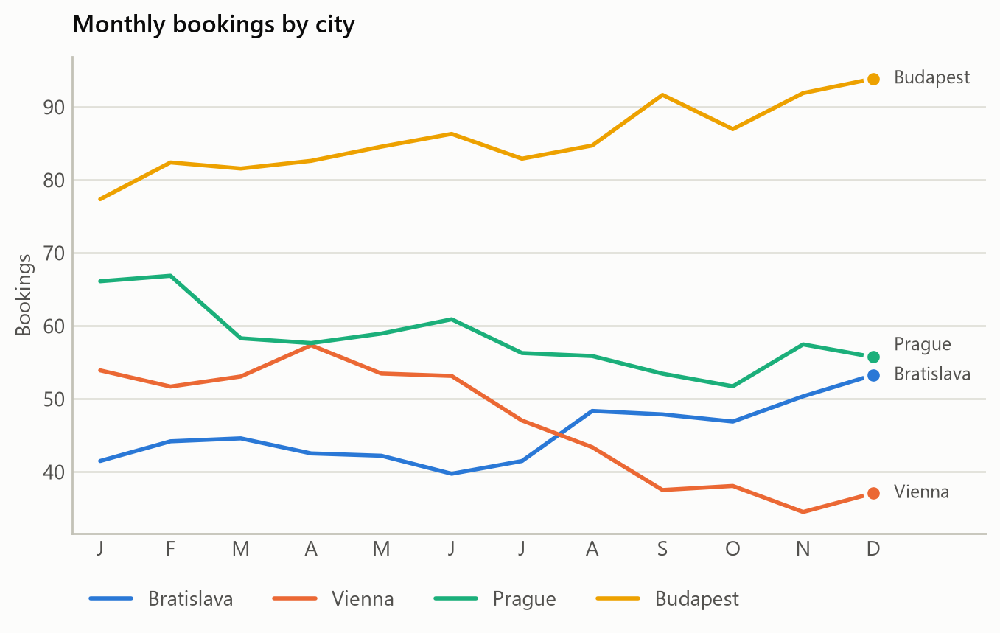
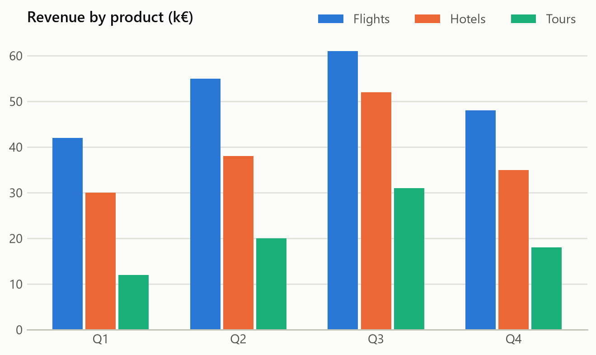
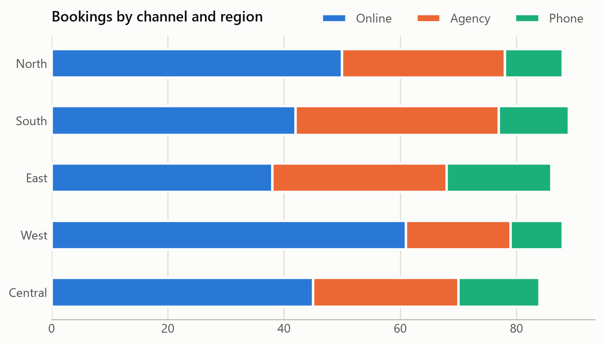
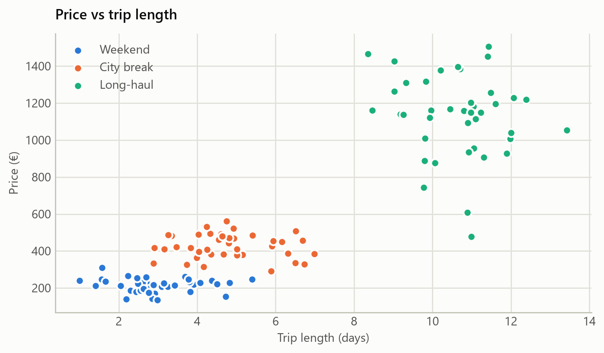
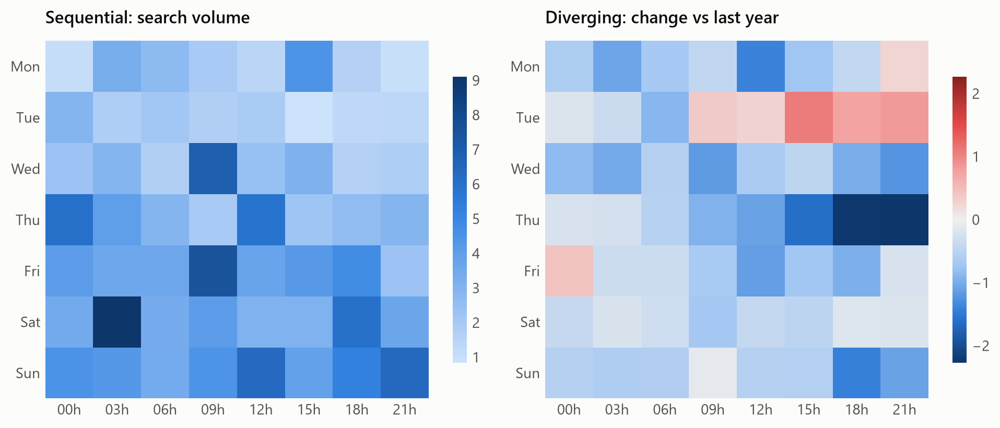

# team-palette

A shared color palette and chart style for matplotlib, so our charts look consistent and stay readable for colleagues with color-vision deficiencies. Light and dark themes are both included.

<picture>
  <source media="(prefers-color-scheme: dark)" srcset="docs/img/palette-dark.png">
  
</picture>

## Install

With [uv](https://docs.astral.sh/uv/):

```bash
uv add git+https://github.com/<OWNER>/team-palette
```

With pip:

```bash
pip install git+https://github.com/<OWNER>/team-palette
```

## Use

```python
import matplotlib.pyplot as plt
import team_palette

team_palette.use()          # or team_palette.use("dark")

plt.plot(x, y1, label="A")  # series get the palette colors in order
plt.plot(x, y2, label="B")
plt.imshow(z, cmap="team_seq")                        # magnitude
plt.imshow(d, cmap="team_div", vmin=-m, vmax=m)       # above / below zero
```

| What | How |
|---|---|
| Categorical colors (list) | `team_palette.colors("light")` |
| Color by name | `team_palette.CATEGORICAL["light"]["orange"]` |
| Sequential colormap | `cmap="team_seq"` (and `team_seq_r`) |
| Diverging colormap | `cmap="team_div"` (and `team_div_r`) |
| Status colors | `team_palette.STATUS["critical"]` |
| Surface / text / grid colors | `team_palette.CHROME["dark"]` |

## Rules of thumb

1. **Use the colors in their fixed order.** The order is what keeps neighbors distinguishable for colorblind readers. Don't shuffle them.
2. **8 series max.** Don't invent a 9th color. Group the rest into "Other" or split into small multiples.
3. **Scatter plots: 3 series max.** In a scatter, every color sits next to every other one, and only the first 3 stay distinguishable in all pairs.
4. **A color belongs to its entity.** If "Vienna" is orange in one chart, keep it orange when you filter others out.
5. **Sequential is for magnitude, diverging is for above/below a midpoint.** Center diverging maps (`vmin=-m, vmax=m`).
6. **Status colors (good / warning / serious / critical) are only for status,** and always come with a text label or icon.
7. **Always add a legend or direct labels.** Color alone should never be the only way to tell series apart.

## Examples

All charts below come from [`examples/make_examples.py`](examples/make_examples.py). Regenerate them with:

```bash
uv run python examples/make_examples.py
```

<picture>
  <source media="(prefers-color-scheme: dark)" srcset="docs/img/line-dark.png">
  
</picture>

<picture>
  <source media="(prefers-color-scheme: dark)" srcset="docs/img/bars-dark.png">
  
</picture>

<picture>
  <source media="(prefers-color-scheme: dark)" srcset="docs/img/stacked-dark.png">
  
</picture>

<picture>
  <source media="(prefers-color-scheme: dark)" srcset="docs/img/scatter-dark.png">
  
</picture>

<picture>
  <source media="(prefers-color-scheme: dark)" srcset="docs/img/heatmaps-dark.png">
  
</picture>

## Development

```bash
uv sync
uv run python examples/make_examples.py
```
