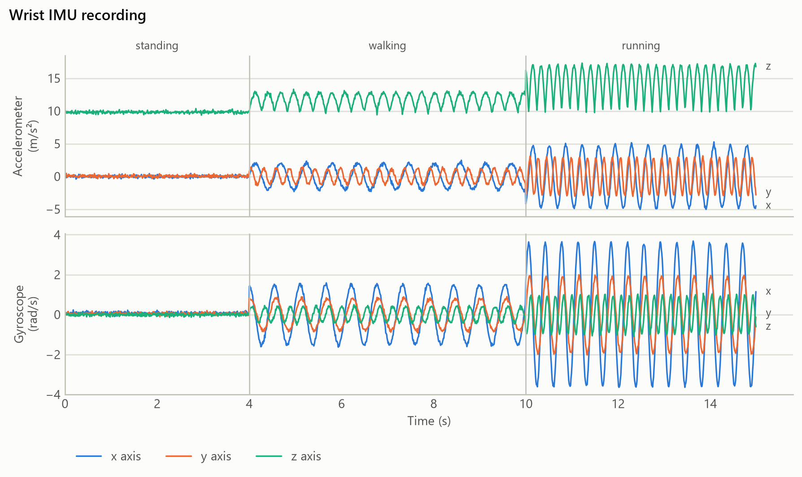
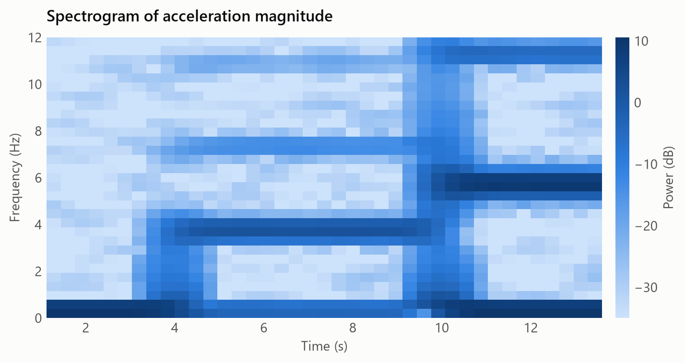
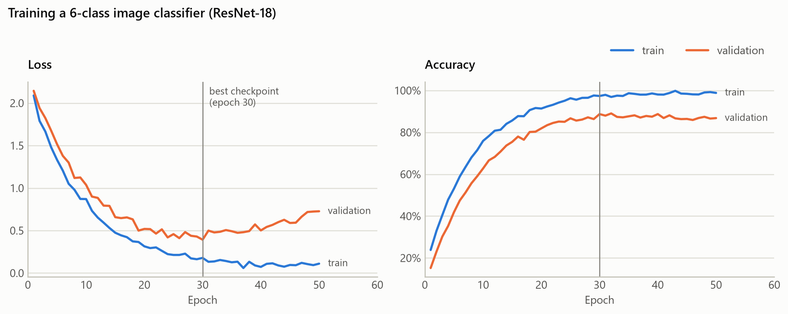
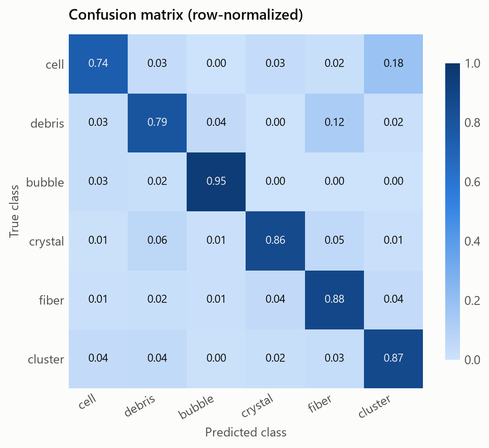
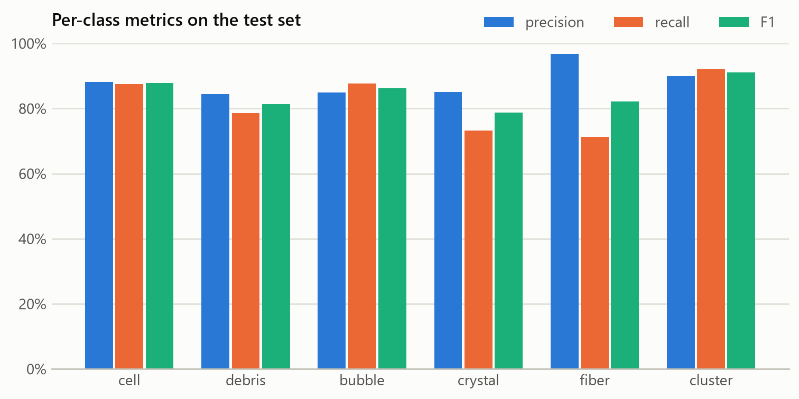
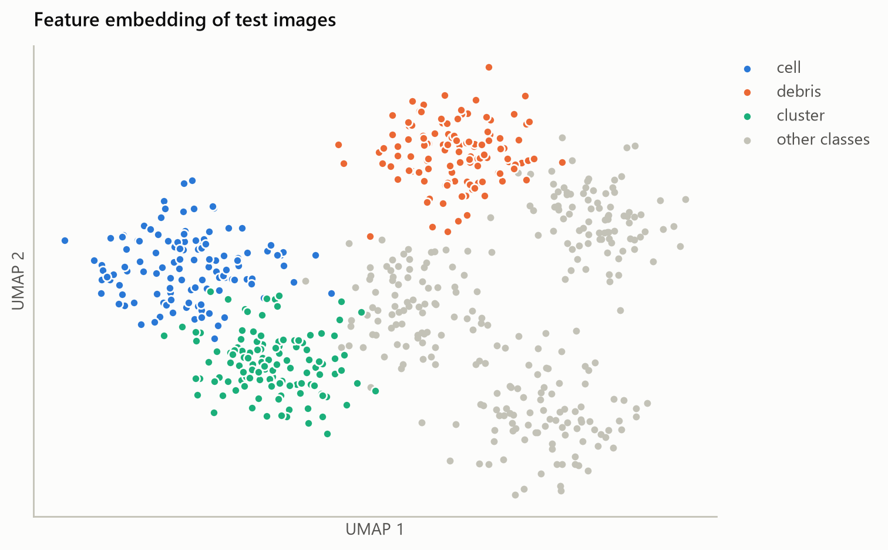
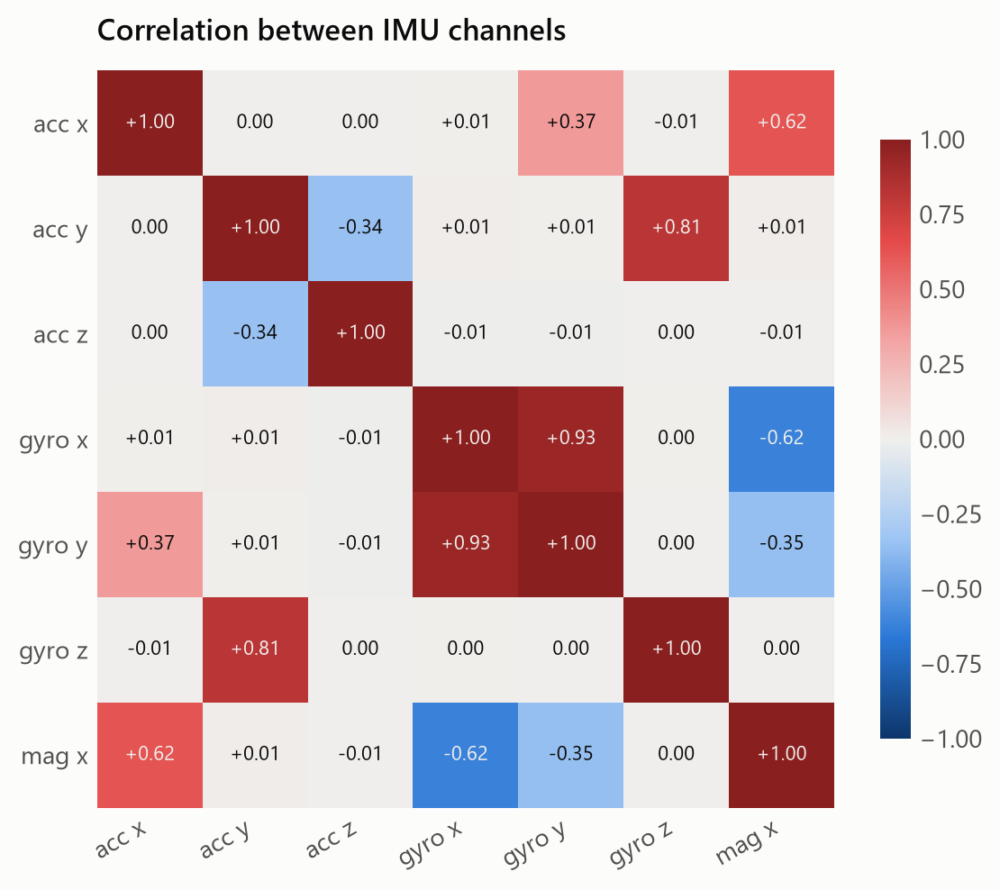

# VC FEIT UNIZA palette

A shared color palette and chart style for matplotlib, so our charts look consistent and stay readable for colleagues with color-vision deficiencies. Light and dark themes are both included.

<picture>
  <source media="(prefers-color-scheme: dark)" srcset="docs/img/palette-dark.png">
  
</picture>

## Install

With [uv](https://docs.astral.sh/uv/):

```bash
uv add git+https://github.com/martin-hanzely/vc-feit-uniza
```

With pip:

```bash
pip install git+https://github.com/martin-hanzely/vc-feit-uniza
```

## Use

```python
import matplotlib.pyplot as plt
import vc_feit_uniza

vc_feit_uniza.use()          # or vc_feit_uniza.use("dark")

plt.plot(x, y1, label="A")  # series get the palette colors in order
plt.plot(x, y2, label="B")
plt.imshow(z, cmap="vc_seq")                        # magnitude
plt.imshow(d, cmap="vc_div", vmin=-m, vmax=m)       # above / below zero
```

| What | How |
|---|---|
| Categorical colors (list) | `vc_feit_uniza.colors("light")` |
| Color by name | `vc_feit_uniza.CATEGORICAL["light"]["orange"]` |
| Sequential colormap | `cmap="vc_seq"` (and `vc_seq_r`) |
| Diverging colormap | `cmap="vc_div"` (and `vc_div_r`) |
| Status colors | `vc_feit_uniza.STATUS["critical"]` |
| Surface / text / grid colors | `vc_feit_uniza.CHROME["dark"]` |

## Rules of thumb

1. **Use the colors in their fixed order.** The order is what keeps neighbors distinguishable for colorblind readers. Don't shuffle them.
2. **8 series max.** Don't invent a 9th color. Group the rest into "Other" or split into small multiples.
3. **Scatter plots: 3 series max.** In a scatter, every color sits next to every other one, and only the first 3 stay distinguishable in all pairs.
4. **A color belongs to its entity.** If "debris" is orange in one chart, keep it orange when you plot a subset of classes.
5. **Sequential is for magnitude, diverging is for above/below a midpoint.** Center diverging maps (`vmin=-m, vmax=m`).
6. **Status colors (good / warning / serious / critical) are only for status,** and always come with a text label or icon.
7. **Always add a legend or direct labels.** Color alone should never be the only way to tell series apart.

### For our kind of data

- **IMU / sensor signals:** x, y, z map to palette slots 1, 2, 3 everywhere. Put accelerometer and gyroscope in **separate panels with a shared time axis** (`plt.subplots(2, 1, sharex=True)`). Never use `twinx()`. For dense signals (≥100 Hz), `lw=1.2` reads better than the default 2 px.
- **Spectrograms, confusion matrices, attention maps, intensity images:** `cmap="vc_seq"`. For dB, clip the floor (`vmin`) so noise recedes.
- **Correlations, residuals, signed errors, before/after differences:** `cmap="vc_div"` with a symmetric range (`vmin=-1, vmax=1`).
- **Training curves:** train is slot 1 and validation is slot 2. Loss and accuracy go in side-by-side panels, not on one twin-axis plot.
- **Embeddings (t-SNE / UMAP) with many classes:** color at most 3 classes of interest and draw the rest in gray (`vc_feit_uniza.CHROME[mode]["axis"]`), or facet into small multiples.

## Examples

The examples use synthetic data shaped like ours: IMU recordings, model training and image-classification results. They all come from [`examples/make_examples.py`](examples/make_examples.py), so copy from there. Regenerate them with:

```bash
uv run python examples/make_examples.py
```

<picture>
  <source media="(prefers-color-scheme: dark)" srcset="docs/img/imu-dark.png">
  
</picture>

<picture>
  <source media="(prefers-color-scheme: dark)" srcset="docs/img/spectrogram-dark.png">
  
</picture>

<picture>
  <source media="(prefers-color-scheme: dark)" srcset="docs/img/training-dark.png">
  
</picture>

<picture>
  <source media="(prefers-color-scheme: dark)" srcset="docs/img/confusion-dark.png">
  
</picture>

<picture>
  <source media="(prefers-color-scheme: dark)" srcset="docs/img/metrics-dark.png">
  
</picture>

<picture>
  <source media="(prefers-color-scheme: dark)" srcset="docs/img/embedding-dark.png">
  
</picture>

<picture>
  <source media="(prefers-color-scheme: dark)" srcset="docs/img/correlation-dark.png">
  
</picture>

## Development

```bash
uv sync
uv run python examples/make_examples.py
```
